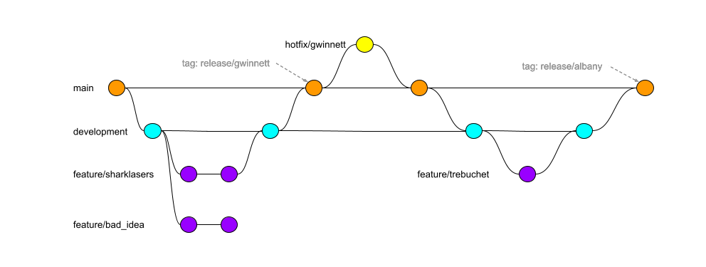

# Team Gitflow

How Ignite works on the competition robot's code — and when that becomes how you work.

---

> **Before M7, this is background.** This page is the team's gitflow, used in `Robot-2026`
> and the other managed repos by people with commit access. You get that access at **M7**,
> when you clear the Kickoff Readiness Gate. Until then you fork `ignition-labs` and
> pull-request into your own fork; see [the git workflow](git-workflow.md).
>
> Nothing here contradicts that. It describes the far side of the same boundary. Read it now
> so that when you clone `Robot-2026` at M2 and find a `development` branch that the git
> workflow never mentioned, you know what you are looking at.

---

## The shape

We use a slightly simplified gitflow. `main` is always what goes to competition, and is only
ever updated from `development` or from a `hotfix` branch. All normal coding happens in
`feature` branches.

Three things in that picture are worth stopping on.

**`feature/bad_idea` never merges.** That is not a mistake in the diagram. Somebody tried
something, it did not work, and the branch was abandoned. Branches that go nowhere cost
nothing and get thrown away constantly. This is the entire reason we work on branches:
nothing you do on one can hurt anybody.

**The tags are competitions.** `release/gwinnett` and `release/albany` mark exactly what code
went to a specific event. When someone asks what we were running at Gwinnett, the tag is the
answer, and it is the only reliable one.

**The hotfix comes back in two hops, not one.** `hotfix/gwinnett` merges into `main`, and
then `main` merges down into `development`. Both hops are drawn — follow the line from that
second orange commit on `main` down to the next `development` commit. It matters that the
second hop happens: without it the fix somebody made at competition is missing from every
feature branched after it, and someone re-breaks it in March.

---

## The branches

| Branch | What it holds | Who writes to it |
|---|---|---|
| `main` | Competition-ready code, and nothing else | Nobody directly. Only merges, from `development` or a `hotfix` |
| `development` | The default branch. Features merged together so they can be tested as a set | Nobody directly. Only merges — from `feature/*`, and from `main` after a hotfix |
| `feature/<num>-<name>` | One feature or fix, for one issue. One, 95% of the time | You |
| `hotfix/<comp>` | Changes made at a competition, branched from `main` | Whoever is at the event |

We do not use `release` branches. Code goes from `development` straight to `main`.

---

## The standard flow

1. Pick up an issue in the **Ready** status, assign it to yourself, and read it. If it is not
   Ready, ask a lead; see [Issues & Projects](issues-and-projects.md#ready).
2. Fetch from all remotes, so you are working from what everyone else has already done.
3. Check out `development`, the default branch, if you are not already on it.
4. Pull, to pick up any updates.
5. Create your feature branch, `feature/<num>-<name>` (for example `feature/42-indexer-jam`),
   and switch to it. Move your card to **In progress**. Branch directly in the Ignite
   repository, no fork.
6. If the change has a spec, commit it first, then open a **draft** pull request into
   `development`. The draft is the spec review.
7. Write the code.
8. Test it. You can deploy to the robot directly from your feature branch.
9. Put `Closes #<num>` in the pull request body and mark it ready for review. If the
   automated build fails, fix it and push again. The pull request updates itself.
10. Review with the other developers and a mentor. Walk them through what you did.
11. If the change has a spec, archive it (`openspec archive`) as the last commit on the
    branch, after the mentor has approved.
12. A lead merges it. The merge closes the issue and moves the card to **Done**. Delete the
    feature branch on GitHub afterward to keep the list short.

---

## The rules

1. **`main` is competition-ready code only.** If it is on `main`, we are willing to drive it.
2. **`development` is where features meet.** You should always have high confidence that
   what is on `development` is ready to go to `main`.
3. **A feature branch holds one feature.** Ninety-five per cent of the time. The exceptions
   are real, and they are exceptions.
4. **Everything merges through a pull request** — features into `development`, and
   `development` into `main`. Branch protection rules on GitHub enforce this.
   - The build, the formatting check, and an automated code review all run when a pull
     request is opened.
   - Every developer and mentor should review every pull request.
   - Fixes during review are just more commits on the same branch; the pull request picks
     them up automatically.
5. **We tag a release before each competition**, named `release/<comp>`, and immediately cut
   a `hotfix/<comp>` branch from `main` for changes at the event.
6. **After the competition the hotfix merges into `main`, and then `main` merges into
   `development`.** Two hops. The second one is what keeps the fix from vanishing off every
   branch cut after the event.
7. **No `release` branches.** `development` goes straight to `main`.
8. **Every change starts from an issue**, and the branch name carries its number:
   `feature/<num>-<name>`. A hotfix at an event is the exception; file it afterwards.
9. **Every feature pull request body carries `Closes #<num>`.** It only works because
   `development` is the default branch.
10. **A failure found after merge opens a new issue that links the old one.** Do not reopen
    the old one.

**One exception, before you have commit access.** At M4 and M6 you open a pull request into
`Robot-2026` from a fork, without commit access — a contribution from outside the team's
branch structure rather than work inside it. [The git workflow](git-workflow.md) says where
that pull request targets. If what it says disagrees with what GitHub actually lets you open,
the repository is right and the page is stale — ask a mentor.

---

## When this becomes yours

At **M7**. Clearing the Kickoff Readiness Gate is what gets you commit access to
`Robot-2026`, and from that point this page stops being background reading and starts
describing your week: your branch is `feature/<num>-<name>`, your pull request targets
`development`, and you never push to `main`.

That is the same boundary as the git ritual. Before the Gate you fork and send pull
requests; after it you branch, like everyone else on the team. The two changed together on
purpose — when you stop forking, it is because the team has decided you can be trusted with
the competition robot's code.

---

## Source

This page is the team's standard for how we use git. For issues, the board, and hotfix
filing, see [Issues & Projects](issues-and-projects.md).
